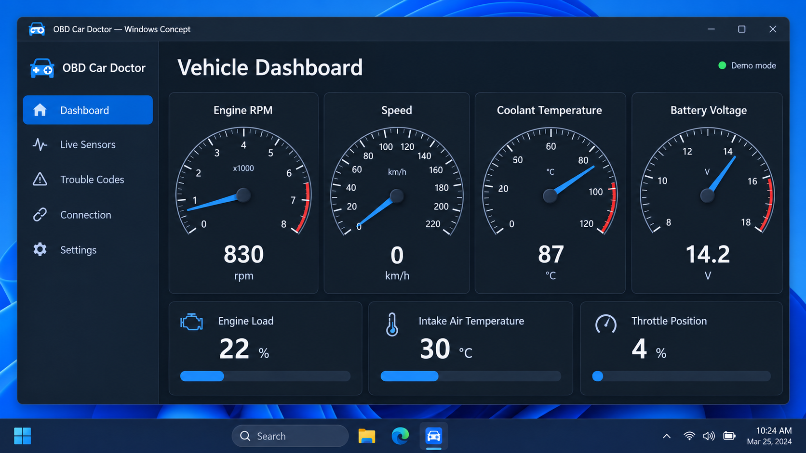
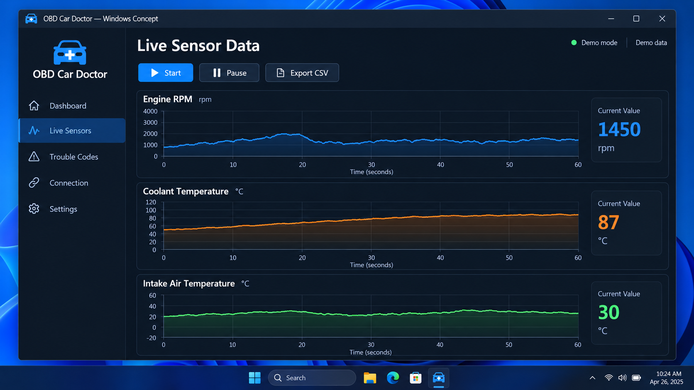
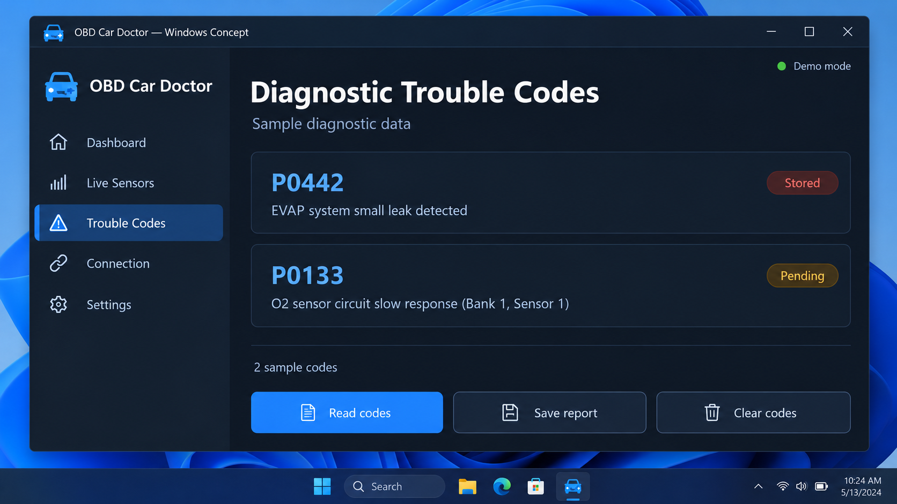

# OBD Auto Doctor - Android OBD-II vehicle diagnostics

OBD Auto Doctor is an Android vehicle-diagnostics project maintained by OBD Car Doctor. It connects to compatible ELM327 Bluetooth adapters, reads diagnostic trouble codes, clears supported faults, and displays live engine data through a focused mobile interface.



[](https://obd-car-doctor.github.io/obd-auto-doctor/obd-auto-doctor)

### What is an OBD Auto Doctor?

OBD Auto Doctor is an OBD2 scanner for Android devices. The application sends standard diagnostic commands through an ELM327-compatible Bluetooth adapter and interprets responses from a vehicle’s on-board diagnostic system.

The OBD Auto Doctor command library covers vehicle speed, engine RPM, coolant temperature, intake temperature, fuel information, pressure values, throttle position, runtime, emissions-related trouble codes, and vehicle identification. OBD Car Doctor organizes these operations into protocol, control, engine, fuel, pressure, and temperature command groups.

## Important resources

The central project files are:

- [AndroidManifest.xml](src/main/AndroidManifest.xml) — Android components and application configuration.
- [MainActivity.java](src/main/java/com/github/pires/obd/reader/activity/MainActivity.java) — Main application activity.
- [ConfigActivity.java](src/main/java/com/github/pires/obd/reader/activity/ConfigActivity.java) — Connection and reader configuration.
- [TroubleCodesActivity.java](src/main/java/com/github/pires/obd/reader/activity/TroubleCodesActivity.java) — Diagnostic trouble-code interface.
- [ObdGatewayService.java](src/main/java/com/github/pires/obd/reader/io/ObdGatewayService.java) — OBD communication service.
- [BluetoothManager.java](src/main/java/com/github/pires/obd/reader/io/BluetoothManager.java) — Bluetooth connection management.
- [ObdCommand.java](src/main/java/com/github/pires/obd/commands/ObdCommand.java) — Base command implementation.
- [ObdProtocols.java](src/main/java/com/github/pires/obd/enums/ObdProtocols.java) — Supported protocol definitions.

### Diagnostic vocabulary

OBD Auto Doctor, OBD Car Doctor, OBD Auto Doctor Car Scanner, OBD2 Scanner OBD Auto Doctor, OBD Auto Doctor Android, obd2, obd-ii, vehicle-diagnostics, car-diagnostics, elm327, diagnostic-trouble-codes, engine-data, automotive-software

## Warnings

> Keep the vehicle parked in a safe, ventilated location while configuring or testing the connection.

> Do not clear diagnostic trouble codes until they have been recorded and their cause has been investigated. Clearing codes can remove useful freeze-frame and emissions information.

> Never interact with a phone while driving. Live readings should be observed by a passenger or reviewed after the vehicle is safely stopped.

Adapter quality varies considerably. A connection failure can come from the OBD Auto Doctor Bluetooth adapter, vehicle protocol support, Android permissions, adapter pairing, or the vehicle itself.

## Features

The OBD Auto Doctor features represented by this repository include:

- Reading stored, pending, and permanent diagnostic trouble codes.
- Clearing supported diagnostic trouble codes.
- Reading the vehicle identification number.
- Detecting available PID ranges.
- Selecting or automatically detecting an OBD protocol.
- Monitoring engine RPM, speed, load, throttle position, and runtime.
- Reading coolant, intake-air, ambient-air, and oil temperatures.
- Monitoring fuel level, fuel trim, fuel pressure, and air-fuel ratios.
- Reading manifold and barometric pressure.
- Reporting control-module voltage and ignition-monitor information.
- Handling adapter errors, unsupported commands, missing data, and connection failures.
- Configuring display units and available commands.



### Is OBD Auto Doctor good?

OBD Auto Doctor provides a practical foundation for standard OBD-II diagnostics. Its strongest area is the structured Java command library: individual classes represent common readings, protocol setup, trouble-code operations, and response failures. This design makes OBD Auto Doctor easier to inspect and extend than an application with all diagnostics embedded in one activity.

Its usefulness still depends on the vehicle and adapter. Not every car exposes every PID, and low-quality ELM327 clones may return malformed data or fail during protocol negotiation. OBD Car Doctor therefore treats unsupported readings and connection errors as expected diagnostic conditions rather than proof that the vehicle is faulty.

The selected repository is focused on Android and Bluetooth. Searches for OBD Auto Doctor Windows, OBD Auto Doctor Linux, OBD Auto Doctor iOS, OBD Auto Doctor USB adapter, or OBD Auto Doctor Windows 10 describe platforms and transports that are not implemented by this Android source snapshot.

## Supported devices

OBD Auto Doctor compatible adapters must provide an ELM327-style command interface over a Bluetooth serial connection.

| Connection | Repository support | Notes |
|---|---:|---|
| Bluetooth ELM327 | Yes | Pair the adapter in Android before opening the connection. |
| Bluetooth ELM327 clone | Variable | Firmware quality and supported commands differ. |
| Wi-Fi ELM327 | Not included | No Wi-Fi transport is present in the selected reader files. |
| USB ELM327 | Not included | The current Android reader does not expose a USB transport. |
| CAN or K-Line adapter without ELM327 | No | Direct CAN, SLCAN, and K-Line operation require separate protocol layers. |

The phrase OBD Auto Doctor ELM327 adapter refers to the expected adapter family. An OBD Auto Doctor USB adapter requires additional Android USB communication code that is not included here.

## Requirements

- A vehicle with an OBD-II diagnostic connector and supported standard protocol.
- An Android device with Bluetooth support.
- An ELM327-compatible Bluetooth adapter.
- Android Studio and an Android SDK for source builds.
- A JDK compatible with the configured Gradle and Android build plugins.
- Permission to use Bluetooth on the target Android version.

Build behavior is defined in [build.gradle](build.gradle), [settings.gradle](settings.gradle), and [gradle.properties](gradle.properties).

## Installation

Clone or obtain the OBD Auto Doctor repository, open it in Android Studio, allow Gradle to synchronize, and select an Android device for deployment.

For command-line builds on Linux or another Unix-like system:

```shell
./gradlew clean assembleDebug
```

For Windows:

```powershell
.\gradlew.bat clean assembleDebug
```

The Gradle wrapper configuration is stored in [gradle-wrapper.properties](gradle/wrapper/gradle-wrapper.properties).

### Is OBD Auto Doctor free?

The source in this OBD Auto Doctor repository is available under the terms recorded in [LICENSE](LICENSE). That file, rather than a pricing claim in this README, controls how the repository may be used, modified, and redistributed.

The repository does not define an OBD Auto Doctor price, OBD Auto Doctor pricing plan, or OBD Auto Doctor Pro purchase system. Hardware is separate: users still need a compatible vehicle adapter and an Android device. Any similarly named store edition, subscription, or commercial service may have different terms and should be evaluated independently.

## Quick start

1. Turn the vehicle ignition on while keeping the engine off unless a reading requires the engine to run.
2. Insert the ELM327 adapter into the vehicle’s OBD-II connector.
3. Pair the adapter through Android Bluetooth settings.
4. Open OBD Auto Doctor.
5. Choose the paired adapter in the configuration screen.
6. Start the connection and allow protocol detection to complete.
7. Open live readings or the trouble-code screen.
8. Record codes before using a clear operation.

The available preferences are declared in [preferences.xml](src/main/res/xml/preferences.xml), while selectable values are defined in [arrays.xml](src/main/res/values/arrays.xml).

## Basic Usage

OBD Car Doctor separates command execution from the Android interface. The reader creates command jobs, sends them through the gateway service, and converts adapter responses into application readings.

Representative commands include:

- [SpeedCommand.java](src/main/java/com/github/pires/obd/commands/SpeedCommand.java)
- [RPMCommand.java](src/main/java/com/github/pires/obd/commands/engine/RPMCommand.java)
- [EngineCoolantTemperatureCommand.java](src/main/java/com/github/pires/obd/commands/temperature/EngineCoolantTemperatureCommand.java)
- [FuelLevelCommand.java](src/main/java/com/github/pires/obd/commands/fuel/FuelLevelCommand.java)
- [TroubleCodesCommand.java](src/main/java/com/github/pires/obd/commands/control/TroubleCodesCommand.java)
- [VinCommand.java](src/main/java/com/github/pires/obd/commands/control/VinCommand.java)

Command support varies by vehicle. OBD Auto Doctor can discover available PID ranges with [AvailablePidsCommand.java](src/main/java/com/github/pires/obd/commands/protocol/AvailablePidsCommand.java).

## Architecture

```text
Android activities and layouts
            |
Reader configuration and command jobs
            |
      OBD gateway service
            |
       Bluetooth manager
            |
    ELM327-compatible adapter
            |
       Vehicle OBD-II ECU
```

The application layers are organized as follows:

- `reader/activity` presents configuration, live readings, and trouble codes.
- `reader/io` manages Bluetooth communication and queued command execution.
- `commands` defines standard OBD-II requests and response conversion.
- `enums` describes protocols, fuel types, fuel trims, and available commands.
- `exceptions` distinguishes adapter, connection, response, and support failures.
- `res` contains the interface layouts, menu, strings, arrays, and preferences.

Unlike a DBC-based CAN reverse-engineering project, OBD Auto Doctor primarily uses standardized OBD-II requests through an ELM327 command interface. It does not provide steering, braking, throttle actuation, ECU flashing, or unrestricted CAN transmission.

## Testing

Build verification can be run with:

```shell
./gradlew clean build
```

Testing should cover:

- A paired physical Bluetooth adapter.
- A vehicle known to support standard OBD-II.
- Protocol initialization and adapter reset behavior.
- Supported and unsupported PID responses.
- Stored, pending, and permanent trouble-code handling.
- Loss of Bluetooth connectivity.
- Malformed or nonnumeric adapter responses.
- Unit conversion and display behavior.

Use a simulator or isolated test setup when developing command behavior. Do not use a live vehicle as the first test environment for unreviewed protocol changes.

## Troubleshooting

If OBD Auto Doctor cannot connect:

1. Confirm that the adapter is powered by the vehicle.
2. Verify that Android has paired with the adapter.
3. Close other applications that may already hold the Bluetooth connection.
4. Reset the adapter and reconnect.
5. Try automatic protocol selection.
6. Confirm that the vehicle supports OBD-II.
7. Test with another known-good adapter when possible.

Common adapter initialization commands disable echo, line feeds, spaces, and headers before protocol selection. The corresponding implementations include [EchoOffCommand.java](src/main/java/com/github/pires/obd/commands/protocol/EchoOffCommand.java), [LineFeedOffCommand.java](src/main/java/com/github/pires/obd/commands/protocol/LineFeedOffCommand.java), [SpacesOffCommand.java](src/main/java/com/github/pires/obd/commands/protocol/SpacesOffCommand.java), and [HeadersOffCommand.java](src/main/java/com/github/pires/obd/commands/protocol/HeadersOffCommand.java).



### Does AutoZone do OBD scans?

Many AutoZone locations offer basic code-reading services, but availability and policy can vary by location. A store scan generally provides a snapshot of stored diagnostic codes and is not equivalent to a complete mechanical diagnosis.

OBD Auto Doctor serves a different purpose. With an adapter connected, it can repeatedly inspect supported readings, monitor engine data, review pending or permanent codes, and preserve direct access to the vehicle during troubleshooting. Neither an AutoZone scan nor OBD Auto Doctor can identify every mechanical cause from a code alone; the code should be combined with proper testing and service information.

## Tested on

OBD Car Doctor recommends validating OBD Auto Doctor with:

- A physical Android device rather than relying only on an emulator.
- A known-good ELM327 Bluetooth adapter.
- More than one supported vehicle protocol when possible.
- Both metric and imperial display settings.
- Vehicles with no stored faults and controlled test cases containing known faults.

## Contributing

Contributions to OBD Auto Doctor should keep commands focused, preserve protocol safety, and include clear failure handling.

Before submitting changes:

1. Read [CONTRIBUTING.md](CONTRIBUTING.md).
2. Build the project with the Gradle wrapper.
3. Avoid embedding vehicle-specific assumptions in standard commands.
4. Document any new adapter requirement.
5. Test error paths as well as successful responses.
6. Do not include private VINs, trip records, or vehicle logs.

Security concerns should follow [SECURITY.md](SECURITY.md).

## License

See [LICENSE](LICENSE).
